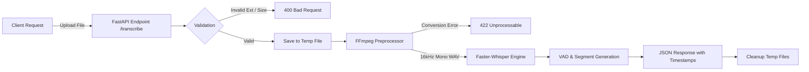

# Audio Transcription API

A production-ready, high-performance Speech-to-Text backend service built with **FastAPI**, **Faster-Whisper**, and **FFmpeg**.

The service accepts diverse audio formats, standardizes the audio pipeline, converts speech to text with precise segment-level timestamps, and returns structured JSON responses with robust error handling.

---

## Table of Contents

- [Overview](#overview)
- [Repository Structure](#repository-structure)
- [Key Features](#key-features)
- [Pipeline Architecture](#pipeline-architecture)
- [Prerequisites](#prerequisites)
- [Installation & Setup](#installation--setup)
  - [Option A: Local Setup](#option-a-local-setup)
  - [Option B: Docker (Recommended)](#option-b-docker-recommended)
- [API Usage & Endpoints](#api-usage--endpoints)
  - [1. Service Info (`GET /`)](#1-service-info-get-)
  - [2. Health Check (`GET /health`)](#2-health-check-get-health)
  - [3. Transcribe Audio (`POST /transcribe`)](#3-transcribe-audio-post-transcribe)
- [Running Automated Tests](#running-automated-tests)
- [Part 2: Production Scaling & Architecture Thoughts](#part-2-production-scaling--architecture-thoughts)

---

## Overview

This project implements the Part 1 requirements for the audio assessment:
- **FastAPI** provides an asynchronous, validated HTTP interface with automatic OpenAPI documentation.
- **FFmpeg** preprocesses incoming audio into standardized 16kHz mono WAV audio, maximizing model accuracy and reducing inference latency.
- **Faster-Whisper** (CTranslate2 implementation of OpenAI Whisper) delivers up to **4x faster inference** and **~70% less memory consumption** using 8-bit quantization (`int8`).
- Segment-level timestamps (`start`, `end`, `text`) are generated alongside full text consolidation and language identification.

---

## Repository Structure

```
audio-transcription-api/
│
├── app/
│   ├── __init__.py         # Package initialization
│   ├── main.py             # FastAPI app, endpoints, schemas, error handlers
│   ├── transcriber.py      # Faster-Whisper model loading and transcription logic
│   └── audio_utils.py      # FFmpeg conversion, format checking, file validation
│
├── tests/
│   ├── __init__.py         # Test package initialization
│   └── test_api.py         # Unit & integration tests (validation, mocking, error flows)
│
├── .gitignore              # Ignored artifacts (weights, temp audio, pycache)
├── requirements.txt        # Pinned dependencies
├── Dockerfile              # Container definition with FFmpeg and model pre-caching
└── README.md               # Documentation and architectural system design
```

---

## Key Features

1. **Multi-Format Audio Upload**:
   - Supports `.wav`, `.mp3`, `.m4a`, `.flac`, `.ogg`, `.webm`, `.aac`, `.wma`, and `.opus`.
   - Streaming file uploads to disk to maintain low server memory overhead.
2. **Audio Preprocessing with FFmpeg**:
   - Automatically converts uploaded files to 16kHz mono 16-bit PCM WAV.
   - Filters silence and standardizes audio channels for optimal acoustic processing.
3. **AI Transcription with Faster-Whisper**:
   - Uses CTranslate2-accelerated Whisper models.
   - Configurable model sizes (`tiny`, `base`, `small`, `medium`, `large-v3`).
   - Defaults to `base` with `int8` quantization for responsive CPU inference.
4. **Segment Timestamp Generation**:
   - Provides granular segment boundaries (`start` and `end` in seconds) and segment text.
   - Calculates detected language and model confidence metrics.
5. **Comprehensive Error Handling**:
   - `400 Bad Request`: Empty files, unsupported extensions, excessive file sizes.
   - `422 Unprocessable Entity`: Corrupt audio headers or FFmpeg conversion errors.
   - `500 Internal Server Error`: Unhandled model inference failures.

---

## Pipeline Architecture



---

## Prerequisites

- **Python 3.10+** (or Docker)
- **FFmpeg** installed on your system PATH:
  - macOS: `brew install ffmpeg`
  - Ubuntu/Debian: `sudo apt-get install -y ffmpeg`
  - Windows: `winget install Gyan.FFmpeg` or `choco install ffmpeg`

---

## Installation & Setup

### Option A: Local Setup

1. **Clone the repository:**
   ```bash
   git clone https://github.com/your-username/audio-transcription-api.git
   cd audio-transcription-api
   ```

2. **Create and activate a virtual environment:**
   ```bash
   python -m venv .venv
   # Windows:
   .venv\Scripts\activate
   # Linux/macOS:
   source .venv/bin/activate
   ```

3. **Install dependencies:**
   ```bash
   pip install -r requirements.txt
   ```

4. **Run the API server:**
   ```bash
   uvicorn app.main:app --host 0.0.0.0 --port 8000 --reload
   ```

5. Access interactive Swagger documentation at [http://localhost:8000/docs](http://localhost:8000/docs).

---

### Option B: Docker (Recommended)

Docker packages Python, FFmpeg, and the pre-cached Whisper model into a single container:

1. **Build the Docker image:**
   ```bash
   docker build -t audio-transcription-api .
   ```

2. **Run the container:**
   ```bash
   docker run -p 8000:8000 --name transcription-service audio-transcription-api
   ```

---

## API Usage & Endpoints

### 1. Service Info (`GET /`)

```bash
curl -X GET "http://localhost:8000/"
```

**Response:**
```json
{
  "service": "Audio Transcription API",
  "version": "1.0.0",
  "docs_url": "/docs",
  "health_url": "/health",
  "transcribe_url": "/transcribe"
}
```

---

### 2. Health Check (`GET /health`)

Monitors service health, model loading state, and FFmpeg availability:

```bash
curl -X GET "http://localhost:8000/health"
```

**Response:**
```json
{
  "status": "healthy",
  "model_size": "base",
  "device": "cpu",
  "model_loaded": true,
  "ffmpeg_available": true
}
```

---

### 3. Transcribe Audio (`POST /transcribe`)

Upload an audio file (MP3, WAV, M4A, FLAC, etc.):

```bash
curl -X POST "http://localhost:8000/transcribe" \
  -H "accept: application/json" \
  -H "Content-Type: multipart/form-data" \
  -F "file=@sample.mp3"
```

#### Optional: Specify Language
To force a specific language rather than auto-detection:
```bash
curl -X POST "http://localhost:8000/transcribe?language=en" \
  -F "file=@sample.wav"
```

#### Example Response (200 OK)
```json
{
  "language": "en",
  "full_text": "Hello, welcome to our application.",
  "segments": [
    {
      "start": 0.0,
      "end": 1.25,
      "text": "Hello,"
    },
    {
      "start": 1.25,
      "end": 2.8,
      "text": "welcome to our application."
    }
  ],
  "duration": 2.8,
  "language_probability": 0.985
}
```

#### Example Error Responses

- **Unsupported file format (400 Bad Request):**
  ```json
  {
    "detail": "Unsupported file format '.pdf'. Supported formats: .aac, .flac, .m4a, .mp3, .opus, .ogg, .wav, .webm, .wma"
  }
  ```

- **Empty file (400 Bad Request):**
  ```json
  {
    "detail": "Uploaded file is empty (0 bytes)."
  }
  ```

---

## Running Automated Tests

The test suite covers route contracts, validation, FFmpeg failures, and mocks model inference to run quickly without downloading model weights:

```bash
pytest
```

Verbose output:
```bash
pytest -v
```

---

## Part 2: Production Scaling & Architecture Thoughts

> **Assessment Note:** As specified in Part 2, these architectural considerations detail the design of a resilient, distributed production transcription platform.

### 1. High Concurrency & Asynchronous Job Architecture
A synchronous HTTP request blocks client connections while long audio files are transcribed. For production scale:
- **Decoupled Job Ingestion**:
  1. Client sends audio upload to `POST /v1/jobs`.
  2. Server saves file to object storage (e.g., AWS S3 / Google Cloud Storage) and enqueues a job event to a message broker (**RabbitMQ** or **Redis Streams**).
  3. API immediately responds with `202 Accepted` and a unique `job_id`.
  4. Clients track status via `GET /v1/jobs/{job_id}`, WebSockets, or a registered Webhook URL upon completion.
- **Worker Pools**:
  - Independent GPU worker nodes consume tasks from the queue.
  - Keeps HTTP ingestion lightweight and resilient to sudden traffic bursts.

### 2. Large File Streaming & Direct Uploads
Uploading 500MB+ audio files directly through the API server causes bandwidth bottlenecks and memory pressure:
- **Pre-Signed URLs**: The client requests an S3 Pre-Signed Upload URL from the API, uploads the audio directly to object storage, and notifies the API when the upload finishes.
- **Resumable Uploads**: Implement the **TUS protocol** or S3 Multipart Upload for unreliable networks, allowing uploads to resume from interruptions.

### 3. Horizontal Autoscaling & Cost Efficiency
- **Autoscaling Workers**: Use Kubernetes with **KEDA** (Kubernetes Event-driven Autoscaling) to scale GPU worker pods based on queue depth (pending jobs) and GPU utilization.
- **Scale to Zero**: During quiet hours, reduce expensive GPU instances to zero, relying on CPU fallback or cold-starting instances on demand.
- **Batch Processing**: Use dynamic batching (e.g., NVIDIA Triton Inference Server) to transcribe multiple parallel audio streams in a single forward pass on GPU.

### 4. Retry Mechanisms & Fault Tolerance
- **Exponential Backoff with Jitter**: When a worker fails due to transient GPU OOM (Out Of Memory) or process crashes, retry the task up to 3 times with exponential backoff (`t = base * 2^attempt + jitter`).
- **Dead-Letter Queue (DLQ)**: Files that fail repeatedly (e.g. unrecoverable codec corruptions or malicious payloads) are routed to a DLQ for inspection, preventing poison-pill tasks from blocking the queue.
- **Idempotency**: Use deterministic job keys (SHA-256 hash of the audio file) so duplicate uploads return existing transcripts without re-incurring GPU costs.

### 5. Observability & Quality Monitoring
- **Prometheus & Grafana**: Track Real-Time Factor (RTF = audio duration / processing time), inference latency, queue wait time, and GPU memory saturation.
- **Transcription Accuracy Monitoring**: Sample transcripts periodically for Word Error Rate (WER) evaluations and language distribution analytics.
